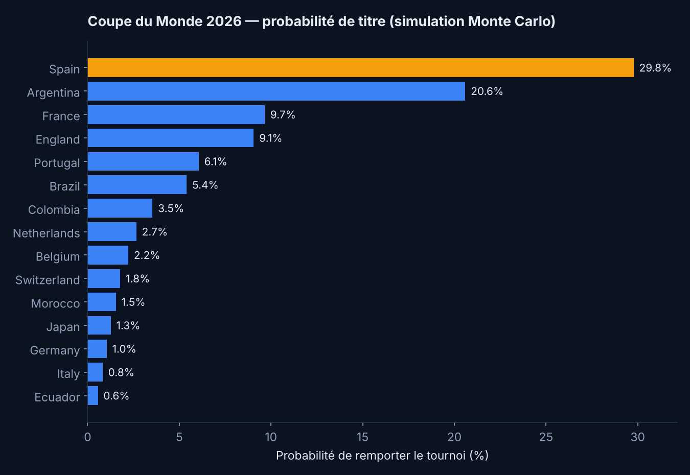
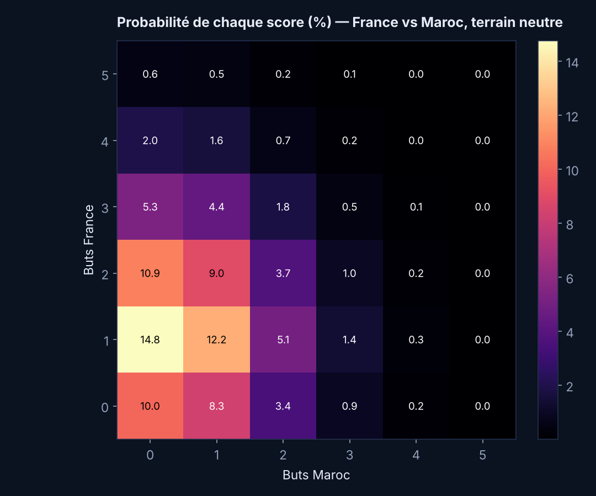

# ⚽ Simulateur de la Coupe du Monde 2026

Prédiction probabiliste de la Coupe du Monde 2026 à partir de **~50 000 matchs
internationaux réels** (1872 → 2026). Notes **Elo**, modèle de buts de **Poisson**
et **simulation de Monte Carlo** du tournoi complet — de la donnée brute jusqu'aux
probabilités de titre.

> Projet portfolio de **Mohammed Zahi** — Data Analyst · Python · économétrie.

---

## 🎯 Ce que fait le projet

À partir de l'historique complet des rencontres entre sélections :

1. il calcule une **note Elo** pour chaque équipe, match après match ;
2. il ajuste un **modèle de Poisson** reliant l'écart d'Elo au nombre de buts marqués ;
3. il en déduit, pour **n'importe quel match**, les probabilités Victoire / Nul / Défaite
   et la distribution des scores ;
4. il **simule 5 000 fois** le tournoi au format 2026 (48 équipes, 12 groupes de 4,
   32 qualifiés, élimination directe) pour estimer la **probabilité de titre** de chaque équipe.

---

## 📊 Résultats (exemple d'exécution)

**Probabilité de remporter le tournoi — top 10 :**

| # | Équipe | Elo | Proba. titre |
|--:|--------|----:|-------------:|
| 1 | Espagne | 2248 | **29.8 %** |
| 2 | Argentine | 2204 | 20.6 % |
| 3 | France | 2134 | 9.7 % |
| 4 | Angleterre | 2125 | 9.1 % |
| 5 | Portugal | 2087 | 6.1 % |
| 6 | Brésil | 2083 | 5.4 % |
| 7 | Colombie | 2040 | 3.5 % |
| 8 | Pays-Bas | 2021 | 2.7 % |
| 9 | Belgique | 2013 | 2.2 % |
| 10 | Suisse | 2006 | 1.8 % |

**Exemple de match — France vs Maroc (terrain neutre) :**
Victoire France **52 %** · Nul **27 %** · Victoire Maroc **21 %**
(buts attendus : 1,47 – 0,83).




---

## 🧠 Méthodologie

**Notes Elo.** Chaque équipe démarre à 1500. Après chaque match, les notes sont
mises à jour selon le résultat, pondéré par l'amplitude du score (un 4‑0 compte plus
qu'un 1‑0) et par l'avantage du terrain (désactivé sur terrain neutre).

**Modèle de buts (Poisson).** Sur les matchs depuis 2006, on régresse les buts marqués
sur l'écart d'Elo et le facteur « à domicile » :

```
buts  ~  Poisson( exp( β₀ + β₁ · ΔElo + β₂ · domicile ) )
```

Les coefficients estimés donnent, pour tout duel, les buts attendus de chaque équipe,
donc toute la distribution des scores.

**Monte Carlo.** Le tournoi est rejoué 5 000 fois : tirage des groupes par pots (Elo),
phase de poules, sélection des 32 qualifiés (2 par groupe + 8 meilleurs 3ᵉˢ), puis
élimination directe (tirs au but départagés par l'Elo). On compte combien de fois
chaque équipe soulève le trophée.

---

## 🗂️ Structure

```
.
├── simulate.py          # pipeline complet (données → Elo → Poisson → Monte Carlo)
├── make_figures.py      # graphiques aux couleurs du portfolio
├── requirements.txt
├── data/                # jeu de données (téléchargé automatiquement)
└── figures/             # sorties : PNG, title_odds.csv, model_export.json
```

## ▶️ Lancer le projet

```bash
pip install -r requirements.txt
python simulate.py        # télécharge les données puis simule (~5 s)
python make_figures.py    # génère les graphiques
```

## ⚠️ Hypothèses & limites

- Le **plateau des 48 équipes** est approché par les 48 meilleures sélections à l'Elo
  (toutes les qualifiées 2026 n'étant pas connues) — hypothèse transparente, facile à remplacer.
- Matchs de tournoi joués sur **terrain neutre** (pas d'avantage du pays hôte modélisé).
- Le modèle ignore blessures, forme du moment et compositions : c'est un modèle
  **statistique de référence**, pas un oracle.

## 📚 Données

Résultats internationaux de [martj42/international_results](https://github.com/martj42/international_results)
(domaine public), ~50 000 matchs de 1872 à 2026.

---

*Reproductible de bout en bout · graine aléatoire fixée · © Mohammed Zahi 2026*
